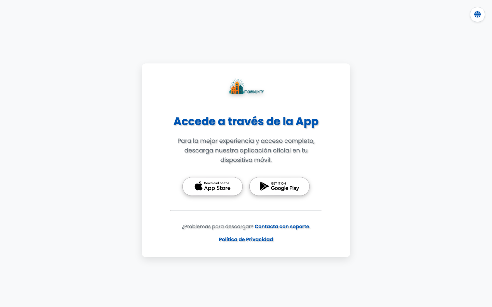

  

<h1 align="center">Juntas — IT-Community</h1>

L'app per le assemblee di condominio dell'ecosistema IT-Community. Convocazioni, documenti e accesso al portale della tua comunità — su Android, iOS, Windows e macOS.

  
  
  
  

🌍 <a href="README.es.md">🇪🇸 Español</a> · <a href="README.md">🇬🇧 English</a> · <a href="README.de.md">🇩🇪 Deutsch</a> · <a href="README.fr.md">🇫🇷 Français</a> · <strong>🇮🇹 Italiano</strong> · <a href="README.pt.md">🇵🇹 Português</a>

> **Questo repository pubblica solo release binarie ufficiali** — il codice sorgente è privato. Download firmati, checksum e feed di aggiornamento automatico.

## Download

| | |
|---|---|
| 📥 **macOS** | [Juntas-<versione>.dmg](https://github.com/mavksoft/juntas-it-community-releases/releases/latest) in ogni release |
| 📱 **Mobile** | Android e iOS — dagli store o tramite [it-community.online](https://it-community.online) |
| 🪟 **Windows** | Installer disponibile in ogni release |
| 🌍 **Sito ufficiale** | [it-community.online](https://it-community.online) |

## Che cos'è

Juntas è l'app delle assemblee dell'ecosistema IT-Community: si collega al portale della tua comunità di proprietari per ricevere convocazioni, consultare i documenti di ogni riunione e seguire la vita della comunità da qualsiasi dispositivo. Questo repository distribuisce i binari pubblici e i feed di auto-aggiornamento.

## Funzionalità

- **Connessione al portale** — l'app si collega al portale IT-Community della tua comunità tramite la directory `portals.json`.
- **Multi-piattaforma** — build per Android, iOS, Windows e macOS.
- **Auto-aggiornamento** — `version.json` e `appcast.xml` alimentano l'updater integrato.
- **Documenti delle assemblee** — convocazioni, verbali e allegati del portale, su mobile e desktop.

## Come si usa

1. Scarica la build per la tua piattaforma dall'ultima release (o installa l'app mobile dal tuo store).
2. Apri l'app e trova la tua comunità nella directory dei portali.
3. Accedi con le credenziali fornite dal tuo amministratore di condominio.
4. Consulta convocazioni, verbali e documenti di ogni assemblea dall'app.

## Requisiti

Android, iOS, Windows 10+ o macOS recente · Richiede un portale IT-Community attivo per la tua comunità (gestito dall'amministratore).

## Cosa contiene questo repository

- `Juntas-<versione>.dmg` — installer macOS firmato
- `Juntas-<versione>.zip` — build impacchettata / archivio di auto-update
- `version.json` — feed di versione per l'updater dell'app
- `appcast.xml` — feed Sparkle per macOS
- `portals.json` — directory dei portali IT-Community usata dall'app
- Il codice sorgente vive nel repo privato `mavksoft/juntas-it-community`.

[Ultima release](https://github.com/mavksoft/juntas-it-community-releases/releases/latest)

## Domande frequenti

**Posso usare l'app se la mia comunità non ha un portale?**  
L'app richiede un portale IT-Community attivo — configurato dall'amministratore della tua comunità.

**Dov'è il codice sorgente?**  
Software privato: questo repository pubblica solo binari e feed di aggiornamento.

## Assistenza

- Sito: [it-community.online](https://it-community.online)
- Email: [hola@it-community.online](mailto:hola@it-community.online)

---

Juntas — IT-Community · © MavkSoft / IT-Systems

